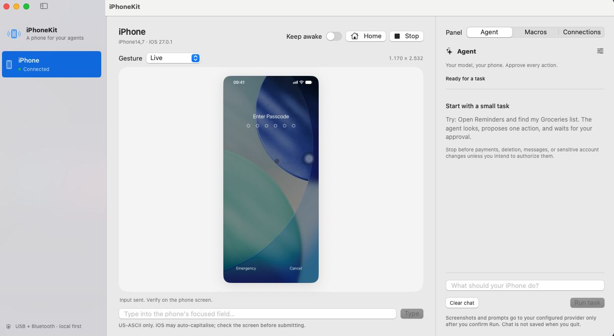

# iPhoneKit

**Native iPhone control for macOS and AI agents.**

iPhoneKit streams a connected iPhone's screen over USB and sends pointer and keyboard input over Bluetooth Classic HID. Control the phone from the Mac app, an MCP client, the local REST API, or the built-in vision agent. Nothing is installed on the iPhone; no jailbreak or Developer Mode is required.

[Demo](#demo) · [Download](#installation) · [Connect a phone](#connect-an-iphone) · [MCP](#mcp) · [REST API](docs/REST.md) · [Development](#development) · [Known issues](#limitations-and-known-issues)

> [!IMPORTANT]
> **v0.1.1 is an experimental preview.** The downloadable app is Apple silicon only, ad-hoc signed, and **not notarized**. Earlier hardware testing used macOS 27 / iOS 27; this release's reconnect and Stop fault cases still need real-device validation. Read the [release notes](docs/releases/v0.1.1.md) before using it with a real phone.

## Demo



*Interface overview. This screenshot shows a locked phone; iPhoneKit cannot bypass its passcode.*

**[Watch or download the 30-second TikTok search demo (MP4)](docs/media/iphonekit-tiktok-demo.mp4)**

The clip opens TikTok from iOS app search, enters `vibe code`, and displays the Videos results. It is a silent, real-time recording of the iPhoneKit window, controlled through the local REST API with the phone unlocked beforehand. The built-in Agent panel remains idle; no passcode entry, likes, follows, or comments are recorded.

Search-result videos are not opened. See [known input limitations](#limitations-and-known-issues).

## Capabilities

| Workflow | What you can do |
| --- | --- |
| Manual control | View the live screen, click and drag, send gestures, type text, return Home, and stop pending input. |
| Vision agent | Connect your own vision model and review each proposed action before it runs. |
| Local game macros | Record gestures, check before/after screens with image matching or OCR, and replay within explicit limits. |
| Agent integrations | Use the bundled stdio MCP helper or authenticated loopback REST API. |
| Offline demo | Explore the interface and test automation without a phone or model credentials. |

The Mac app owns the USB capture, Bluetooth connection, and platform permissions. The MCP helper connects to the running app; it does not access hardware itself.

## Installation

### Requirements

- An Apple silicon Mac for the prebuilt app, with macOS 14.6 or later. The minimum version is a build target, not a guarantee of compatibility across untested OS versions.
- An iPhone, a USB data cable, and Bluetooth enabled on both devices.
- An unlocked phone for initial trust and pairing. Pointer input requires portrait orientation.

### Download the preview

1. Download `iPhoneKit-0.1.1-macos-arm64.zip` and `SHA256SUMS` from the [v0.1.1 release](https://github.com/quangtuyen88/iphone-kit/releases/tag/v0.1.1).
2. Verify the ZIP from the directory containing both downloads:

   ```bash
   shasum -a 256 -c SHA256SUMS
   ```

3. Extract the ZIP and move `IPhoneKit.app` into Applications. Quit any existing copy with **Cmd+Q** before replacing it.
4. Open the app. Because this preview is not notarized, macOS may block it. Only if you trust the release, use **System Settings > Privacy & Security > Open Anyway** after attempting to open it. Do not disable Gatekeeper globally.

Ad-hoc updates and rebuilds may require new Camera and Bluetooth grants. To build your own copy, see [Development](#development).

## Connect an iPhone

1. Connect the USB data cable. Unlock the phone, tap **Trust This Computer**, and enter its passcode.
2. Select the phone in iPhoneKit and choose **Enable control**. Allow **Camera** and **Bluetooth** when macOS asks. Camera access captures the USB iPhone screen, not your Mac's webcam.
3. On the phone, open **Settings > Bluetooth** and select this Mac. Accept pairing prompts on both devices. Keep that page open until iPhoneKit reports **Connected and ready**.
4. For multiple phones, explicitly select and verify each phone's screen source before sending input.

For longer sessions, consider **Settings > Display & Brightness > Auto-Lock > Never** and the wired-accessory setting under **Settings > Privacy & Security**. iPhoneKit cannot bypass a passcode or iOS USB security. Keep awake can help maintain an unlocked session, but it does not replace these settings.

> [!NOTE]
> Setup enables AssistiveTouch after recording its previous value. **Cmd+Q** stops control and restores that value; closing the window does not quit the app. If the phone is locked or unplugged during shutdown, restoration remains pending and is retried after reconnection at the next launch.

## Control workflows

### Manual control

Use the live preview for clicks and drags, or choose tap, double/triple tap, long press, flick, drag, or hold-and-drag. Keyboard input is US-ASCII; the phone's keyboard layout, focus, and autocapitalisation still apply. Check the screen before submitting text.

- **Home** returns to the phone's Home screen.
- **Stop** cancels queued actions and releases held inputs.
- **Keep awake** sends a modifier-only Bluetooth pulse after 20 seconds without phone input. It is off by default, stops on unplug or quit, and is not persisted.

### Built-in vision agent

1. Open the **Agent** panel and select **Model settings**.
2. Enter an OpenAI-compatible Chat Completions base URL, a vision-capable model, and an API key if required.
3. Select a ready phone, enter a task, and choose **Run task**.
4. Review the provider and screenshot-sharing disclosure, then approve each proposed action with **Approve action**.

The provider must support image input, JSON-object replies, and `max_tokens`. HTTPS is required except for literal loopback HTTP, such as `http://127.0.0.1:1234/v1`; redirects are blocked. Saving settings does not contact the provider. Compatibility requires a live test with your chosen provider and your consent.

Each run stays pinned to its starting phone and stops at 20 steps. Reject or Stop cancels the task; uncertain input is never automatically replayed. Review actions involving purchases, messages, deletion, or private accounts carefully. Demo mode uses an offline scripted planner instead of your provider.

### Local game macros

The **Macros** panel uses local image matching and optional OCR on the Mac. No model provider is involved.

1. Open a portrait game on a ready phone, choose **New**, then **Record gestures**.
2. Perform one gesture on the preview. Wait for a visible result and choose **Capture result**. Repeat as needed, then select **Finish recording**. An action needs a distinguishable result to be recorded.
3. Review each step's before/after images, matching region, optional required text, delay, timeout, and approval setting. Individual approval is on by default.
4. Set session limits and, optionally, capture a goal screen as a stop condition. Choose **Save profile**, then **Review & run** and **Approve & run**.

A profile supports up to **20 steps**, **20 loops**, **100 actions**, and a **5–600 second** session, including waits and approvals. Recording and playback own the phone's input exclusively: manual, API, MCP, and keep-awake input cannot interleave. Stop with **Stop** or **Cmd+.**.

Unexpected screens, connection changes, timeouts, or uncertain outcomes pause or stop the run. Before input, a fresh target match and full-screen context check are required, including a check at the queued dispatch boundary. Animations and background changes can pause replay.

Stop waits for pending work to settle. Recovery shows the last verified step and the interrupted command's outcome; inspect the phone and approve a new run before continuing. A new run starts at step 1 and may repeat earlier effects; failed actions are never automatically retried. See [macro safety and validation limits](docs/MACRO-SAFETY.md).

Use your own account and follow the game's rules; do not include purchases, sign-in, messaging, or account changes in automatic loops. Keep distinctive context in matching regions and avoid the floating AssistiveTouch button.

## Integrations

### MCP

Keep iPhoneKit running, choose **Copy MCP configuration**, and paste the result into your client's configuration. The bundled `iphonekit-mcp` helper uses stdio and works with clients such as Claude Code and Codex.

<details>
<summary>Available MCP tools</summary>

| Category | Tools |
| --- | --- |
| Observation | `list_phones`, `get_phone_status`, `screenshot` |
| Pointer input | `tap`, `double_tap`, `triple_tap`, `long_press`, `flick`, `drag`, `hold_and_drag` |
| Keyboard and navigation | `type_text`, `press_key`, `press_home` |
| Session control | `wake`, `set_keep_awake`, `cancel_action` |

</details>

Take a screenshot before pointer actions and pass its `screenshot_id`. Coordinates refer to pixels in the returned JPEG, not a resized preview or UIKit points.

> [!WARNING]
> **`sent` does not mean the intended action succeeded.** Take another screenshot to verify the result. MCP and REST calls do not use the built-in agent's per-action approval dialog; clients must obtain appropriate user approval before sensitive actions. Never blindly retry uncertain input.

### REST API

The default endpoint is `http://127.0.0.1:8766`. Choose **Copy API key** in the app and set `IPHONEKIT_API_KEY` in your shell to that token before making an authenticated request:

```bash
curl --header "X-API-Key: ${IPHONEKIT_API_KEY}" \
  http://127.0.0.1:8766/v1/phones
```

All device routes require `X-API-Key` or `Authorization: Bearer`. Browser-origin requests are rejected; the server has no CORS or public listener. The app must remain running.

See the [REST reference](docs/REST.md) for routes, payloads, coordinate rules, idempotency, and error handling. `IPHONEKIT_PORT` and `IPHONEKIT_API_KEY` can override the server's port and token. `--headless` runs the app as a background user-session host while retaining its platform run loops and privacy identity.

## Privacy and safety

Core phone control and macro processing run on your Mac. An authorized vision-agent task sends screenshots, your prompt, and recent actions to the configured provider. External MCP clients can also forward requested data to their own model providers; connect only clients you trust. iPhoneKit has no hosted relay or telemetry.

| Data | Handling |
| --- | --- |
| Provider API keys | Stored in this Mac's Keychain, scoped to the endpoint's scheme, host, and port. Changing endpoints does not reuse another endpoint's key. |
| Local API token | Stored at `~/Library/Application Support/iPhoneKit/api-token` with owner-only `0600` permissions. |
| Saved macro profiles | Stored at `~/Library/Application Support/iPhoneKit/macros.json` with private permissions, including full-screen reference JPEGs. |
| Known devices | Phone identifiers, model information, and Bluetooth addresses are cached locally with owner-only permissions. |
| Agent chat | Kept in memory by the app and not saved when it quits. Your provider's data policy applies to content shared with it. |

Cropping a macro's matching region **does not redact the stored screenshot**. Avoid recording private screens. Demo profiles use separate temporary storage; macro self-tests use isolated disposable stores.

## Limitations and known issues

- **TikTok search results:** short HID clicks did not open video thumbnails in hardware testing, although tab navigation and a long-press menu worked. The cause remains unverified; 150 ms and 250 ms presses did not resolve it.
- **Input model:** Bluetooth HID provides a single pointer and keyboard, not multi-touch injection. Landscape capture works, but uncalibrated landscape pointer input fails closed. Some system or screen-edge gestures need keyboard alternatives.
- **Visual verification:** overlays and last-moment screen changes can invalidate an approval or image match. On-screen instructions are untrusted data. Pointer metadata reports its last commanded position, not a detected or guaranteed-visible cursor.
- **Platform coverage:** private Apple interfaces can change with OS updates. Older OS combinations, multi-phone throughput, real-game reliability, and long unattended runs remain unverified. Bluetooth congestion and latency still need hardware testing.
- **Distribution:** this preview is not notarized. There is no hosted account, subscription service, cloud relay, remote MCP/OAuth, or browser live streaming.

See the [v0.1.1 release notes](docs/releases/v0.1.1.md) for the preview's distribution and compatibility details.

## Development

### Build from source

Use macOS 14.6+ with a Swift 6.2+ toolchain and the macOS SDK.

```bash
git clone git@github.com:quangtuyen88/iphone-kit.git
cd iphone-kit
scripts/build-app.sh
open dist/IPhoneKit.app
```

The build script uses an available Developer ID or Apple Development identity, falling back to ad-hoc signing. Set `CODESIGN_IDENTITY` to choose an identity; `-` explicitly selects ad-hoc signing. A stable identity preserves privacy grants across rebuilds. The script does not notarize the app or provide a complete Developer ID distribution workflow.

Set `IPHONEKIT_APP_PATH` to a new bundle path when building and running the Python checks to keep release verification separate from an app currently controlling a phone.

### Test without hardware

From a built source checkout, quit any real-phone instance before starting the demo:

```bash
swift test
open dist/IPhoneKit.app --args --demo
python3 scripts/smoke-test.py
python3 scripts/verify-macros.py
python3 scripts/verify-shutdown.py
```

Demo mode never accesses phone hardware or a model provider. The smoke test exercises REST and the bundled stdio MCP helper. Macro verification records two steps, checks four actions and two approvals, verifies private save/reload, and shuts down cleanly. Shutdown tests verify SIGTERM and SIGINT cleanup in owned demo processes. Swift tests cover report encoding, gestures, cancellation, input ownership, connection epochs, storage failures, visual matching, and HTTP security.

<details>
<summary>Development flags</summary>

| Arguments | Purpose |
| --- | --- |
| `--demo --ui-snapshot` | Render an owned demo window to `/tmp/iphonekit-ui.png` without Screen Recording permission. |
| `--demo --agent-self-test --ui-snapshot` | Run the offline agent flow with simulated approval and capture the result. |
| `--demo --macro-self-test --ui-snapshot` | Exercise the macro workflow and select the Macros panel. |
| `--headless` | Run the app as a background user-session host. |
| `--auto-prepare` | Explicitly set up attached real phones; this can change AssistiveTouch after permissions are approved. |

Macro self-tests write `report.json` and `macros.json` to a unique private temporary directory. `IPHONEKIT_MACRO_TEST_DIRECTORY` overrides that directory only in demo self-test mode.

</details>

## Documentation

- [REST API reference](docs/REST.md)
- [Macro safety and validation limits](docs/MACRO-SAFETY.md)
- [Release notes](docs/releases/v0.1.1.md)
- [Platform evidence and original feasibility spike](docs/FEASIBILITY.md)

The original hardware probe remains in `spikes/hid-probe/`, separate from the app.
